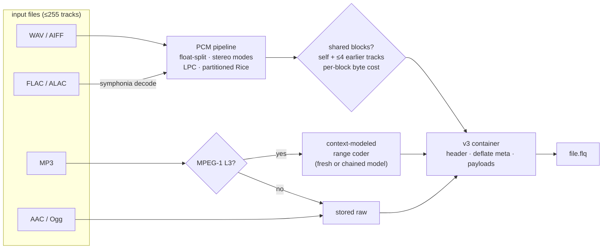
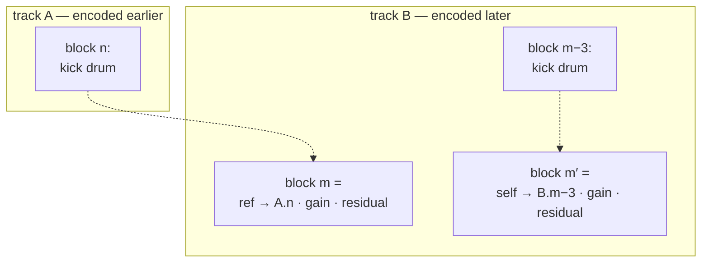
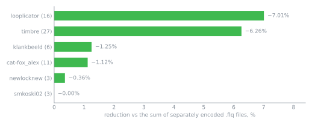

# FLQ — Filon Lossless Quality

[](https://github.com/nFeelon/flq-audio/actions/workflows/ci.yml)


A lossless audio **container + codec** that packs multiple tracks into a
single `.flq` bundle — with cross-track compression for related audio.

FLQ looks for repeated low-level audio content **within** a track and
**across** related tracks. When a block can be represented more efficiently
using an earlier block as a reference, FLQ stores only the residual instead
of encoding the block independently.

| Guarantee | What it means |
|---|---|
| **Byte-exact** | WAV, AIFF and MP3 tracks come back bit-for-bit identical |
| **Sample-exact** | FLAC/ALAC tracks decode to identical PCM samples; supported metadata is preserved where representable; the file itself is re-encoded |
| **Adaptive** | coding method is chosen per block; anything not beneficial falls back to plain storage |

**Benchmark headline.** On a common 47-file subset accepted by every
compared tool, FLQ produced 50.5% of the source size, compared with
51.2% for FLAC -8 and 52.0% for WavPack -hx.

FLQ produced smaller files on 44/47 inputs than FLAC and 36/47 than
WavPack. TAK and OptimFROG achieved smaller aggregate output sizes.

These results compare compression ratio, not overall performance: FLQ
encoding was approximately 4–80× slower than the reference codecs in
the tested configurations.

[Full comparison and methodology](#vs-reference-codecs).

## Quick start

```console
cargo run --release -- encode drums1.wav drums2.wav theme.flac bundle.flq
cargo run --release -- decode bundle.flq -o restored/
cargo run --release -- decode bundle.flq --only drums2.wav   # extract one track
cargo run --release -- bench a.wav b.mp3                     # dry run: sizes, gain, timing
```

Requires Rust 1.85+ (edition 2024). The release binary lands at
`target/release/flq` — it is not added to PATH.

Accepted inputs: `.wav` `.aiff/.aif/.aifc` `.flac` `.mp3` `.m4a/.mp4`
(ALAC or AAC) `.aac` `.ogg` (Vorbis/Opus). Up to 255 tracks per file.
No codec-tuning flags — encoding decisions are adaptive; `encode`/`bench`
take `--no-joint` to skip reference analysis (used for the ablation below);
`decode` adds only `--format flac|wav` for FLAC/ALAC tracks and `--only`
for subset extraction.

## What each format becomes

| Input | Inside `.flq` | You get back | Guarantee |
|---|---|---|---|
| WAV | FLQ PCM (joint LPC + Rice) | the original file | byte-exact |
| AIFF / AIFF-C | FLQ PCM | the original file | byte-exact |
| FLAC | FLQ PCM + tag blob | re-encoded FLAC (or WAV) | sample-exact |
| ALAC (`.m4a`) | FLQ PCM + tag blob | FLAC (or WAV) | sample-exact |
| MP3 (MPEG-1 L3) | range-coded structure | the original file | byte-exact |
| MP3 (other), AAC, ADTS, Ogg Vorbis/Opus | stored as-is | the original file | byte-exact |

Per block and per track the encoder rejects any representation that isn't
smaller than its alternatives — so no track pays for an encoding that didn't
help. The container adds only a small deflated metadata record per track
(measured ~30 KB total across a 668 MiB / 47-file set), so a bundle of
unrelated, already-incompressible files can end up slightly larger than
the inputs.

## How it works



**Shared blocks.** Audio is split into 4096-sample blocks (~93 ms). A block
coded by reference stores `source track · lag · gain` plus a residual —
the earlier material is used as the predictor, the difference is still coded.
A reference wins a block only when it is strictly fewer bits, which is why
merely-correlated noise (high NCC, unpredictable) is correctly declined.



Sources: earlier blocks in the current track, plus **up to four screened
earlier PCM tracks** at the same sample rate — drum-loop stems reuse
themselves heavily. MP3 tracks instead chain the range coder's adaptive
statistics (mode 2). All track metas deflate together.

**Container layout (v3):**

```text
"FLQ1" | version u8 | ntracks u8 | block u32
meta_mode u8 | meta_raw_len u32 | meta_len u32 | meta (deflate if smaller)
payload[0] | payload[1] | ... | payload[n-1]        (lengths live in metas)
```

v1/v2 files still decode. Details: [`src/container.rs`](src/container.rs)
doc comment, [`AGENTS.md`](AGENTS.md).

## Measured results

Corpus: 256 files, 2236.2 MiB in → **1504.1 MiB packed (67.3%), −732.1 MiB** —
all 256 passed their format-specific round-trip checks: byte-exact where
supported, sample-exact for FLAC/ALAC. Sweep @ `1856cdf`; pair/group rows
@ `a4b1e34`.
Dated reports: [`testdata/results/`](testdata/results/).


| Case | Result |
|---|---|
| WAV int / float | 54.6% / 53.2% of source |
| MP3 MPEG-1 L3 (modeled, 59 files) | 84.3% avg / 83.6% median / 76.3% best |
| FLAC → PCM | ~98% (near parity with FLAC) |
| AAC / Ogg / stored raw | ≈100% payload size, plus container metadata |

Bundling related files adds further savings on top of single-file packing.
Groups below are freesound.org **author packs** — files uploaded by one
creator (looplicator, timbre, klankbeeld…) tend to share sources, so they
compress together:



### Real run

Two layered sound-design stems from the corpus (file names shortened):

```text
$ flq bench *_top-impact.wav *spell-design-1.wav
  1 …_top-impact.wav      1,033,476 B   wav f32 2ch 44100 Hz
  2 …_spell-design-1.wav  1,078,324 B   wav f32 2ch 44100 Hz
Output .flq               1,196,490 B   ratio 1.765x   (56.66% of inputs)
  2 …spell-design-1.wav: on - track 1 in 21/33 blocks, max NCC 0.656
bundle: references saved 160,976 B (7.62% of input)
Encode  wall 0.490 s   peak heap 46.2 MiB   speed 12.2x realtime
Decode  wall 0.026 s   peak heap 14.3 MiB   speed 231.7x realtime
Accuracy: both tracks bit-exact
```

### vs reference codecs

Same corpus, same files, single-file encode, verified decode. On the
47-file subset every tool accepted (identical inputs):

| Codec | Output, % of source |
|---|---|
| OptimFROG extranew-light | 48.4% |
| TAK -p4m | 49.9% |
| **FLQ** | **50.5%** |
| Monkey's Audio -c4000 | 50.9% |
| FLAC -8 | 51.2% |
| WavPack -hx | 52.0% |
| 7-Zip LZMA2 -mx9 | 64.6% |
| Zstd --ultra -22 | 78.1% |


Aggregate percentages hide the per-file picture, so here are the
pairwise counts — a "win" means FLQ's file is smaller on that input:

| FLQ vs | wins /47 | losses | median delta |
|---|---|---|---|
| FLAC | 44 | 3 | +0.66 pp |
| WavPack | 36 | 11 | +1.09 pp |
| Monkey's Audio | 24 | 23 | +0.01 pp |
| TAK | 9 | 38 | −0.55 pp |
| OptimFROG | 5 | 42 | −1.59 pp |
| 7-Zip | 41 | 6 | +14.26 pp |
| Zstd | 44 | 3 | +25.86 pp |

Delta = reference codec size (% of source) − FLQ size (% of source).
Positive values mean FLQ produced smaller files.

The FLAC and WavPack leads are consistent across files; APE is a
near-tie in per-file results on this subset (24 wins, 23 losses;
+0.01 pp median difference); OptimFROG and TAK stay ahead.

#### ablation: which stage earns it

`flq encode --no-joint` skips reference analysis entirely, and the
encoder stats expose each pipeline stage. Payload bytes, same 47 files:

| Pipeline stage | % of source | per-file vs FLAC |
|---|---|---|
| per-channel LPC/Rice | 50.95% | 32 win / 15 loss |
| + stereo decorrelation | 50.77% | — |
| + self/cross references (full FLQ) | 50.51% | 44 win / 3 loss |

So the LPC/Rice core alone is already at/below FLAC's file-level size;
stereo modes and references add ~0.4 pp on single unrelated files
(references earn much more on related multi-track bundles — see the
bundle chart above). This is a codec comparison, not a container trick:
non-audio bytes per output are 30,454 B for FLQ (0.004%) vs 402,798 B
for FLAC (0.06%) and 1,002,926 B for WavPack (0.14%), summed over the
same files.

Its edge is coverage: FLAC rejected 69/148 corpus files (float WAV,
AIFF, odd headers), OptimFROG 69, TAK 94, while FLQ, WavPack and APE
took all 148 — plus joint cross-track coding none of the reference
codecs have. The honest cost: encode is ~4–80× slower than the
reference codecs (the joint analysis pass is ~2/3 of that — 458 s vs
153 s for the subset); decode stays fast (~0.2 s/file). PAQ8PX is the
theoretical extreme, not a practical one (~61% at ~2,000× FLAC's encode
time). Full method, settings, per-format tables and the ablation:
[`2026-10-22_e254a5b.md`](testdata/results/2026-10-22_e254a5b.md)

## Modules

| Path | Role |
|---|---|
| `src/codec.rs` | float split, stereo modes, LPC, block plan/write/read |
| `src/joint.rs` | FFT/NCC analysis, reference candidate screening |
| `src/bits.rs` | MSB-first bit IO, partitioned Rice + escape, CRC32 |
| `src/container.rs` | wire format, encode/decode/subset, stats |
| `src/formats.rs` | sniffing, FLAC/ALAC decode, tag blobs, FLAC output |
| `src/wav.rs` · `src/aiff.rs` | byte-exact container parsing/write-back |
| `src/mp3/` | MPEG-1 L3 parser, Huffman codec, adaptive range coder |
| `src/main.rs` | CLI + timing/heap metrics |

Deeper architecture + wire-format spec: [`AGENTS.md`](AGENTS.md).

## Limitations

**Memory.** Whole-file-in-memory codec — encode peak ≈ 20× input size
(~1.9 GiB heap on a 76 MiB bundle). No streaming.

**Format coverage.** MP3 modeling is MPEG-1 Layer III only — MPEG-2/2.5,
Layer I/II, free-format → raw. FLAC/ALAC tracks are re-encoded on output:
samples and tags preserved, original file bytes are not. ALAC comes out as
FLAC; SEEKTABLE/PADDING not preserved; `--format wav` drops tags. PCM kind:
8/16/24-bit only.

**Structure.** 255 tracks max per `.flq`. Cross-references and MP3 mode-2
chains are sequential decode dependencies — extracting one track
(`--only`) still resolves its reference closure, and one bundle is one
failure domain.

**Status.** Experimental, pre-1.0. v1/v2 containers keep decoding; v3 is
the current write format. Benchmarks above were measured at commits
`1856cdf` / `a4b1e34`.

## Development

```console
cargo test --release                # 98 tests
cargo test --release -- --ignored   # + real-file fixture tests (testdata/)
cargo clippy --release --all-targets
```

CI: GitHub Actions (`.github/workflows/ci.yml`) — build, tests and clippy
on Ubuntu and Windows.

- [`AGENTS.md`](AGENTS.md) — invariants, wire format, contributor notes
- [`testdata/`](testdata/) — tracked fixtures + dated measurement reports
- [`docs/make_assets.py`](docs/make_assets.py) — regenerates the banner
  and charts above

## License

[MIT](LICENSE) © 2026 Nikita Filon
