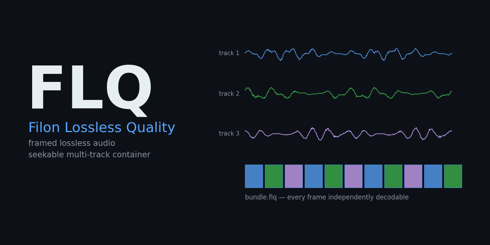
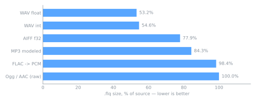
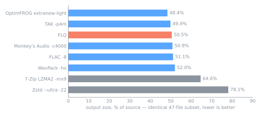

# FLQ — Filon Lossless Quality

[](https://github.com/nFeelon/flq-audio/actions/workflows/ci.yml)


FLQ is a lossless audio format for multi-track material: up to 255 tracks
(e.g. stems) coded as independent, CRC-checked frames of 16384 samples.
Every frame decodes on its own, so a player can jump anywhere, extract a
single stem, or keep going past a damaged frame — and a decoder needs
O(frame) memory. Inputs are WAV, AIFF/AIFF-C, FLAC and ALAC; samples are
kept exactly, and FLAC/ALAC tag blocks ride along. The bitstream is
specified in [`docs/SPEC-v1.md`](docs/SPEC-v1.md) with conformance vectors
in [`testdata/v1/`](testdata/v1/).

**Benchmark headline.** On a common 47-file subset accepted by every
compared tool, `flq encode` produced 50.9% of the source size, compared
with 51.2% for FLAC -8 and 52.0% for WavPack -hx — smaller files than
FLAC on 43/47 inputs and than WavPack on 31/47. Monkey's Audio (50.85%,
smaller than FLQ on 29/47), TAK and OptimFROG compress further.

These results compare compression ratio, not overall performance: at
equal thread count FLQ's LPC/Rice path encodes ~8–9× slower than FLAC -8
(8.8 vs 67.6 MiB/s on 1 thread, 30.8 vs 285.7 MiB/s on 8).

[Full comparison and methodology](#vs-reference-codecs).

## Quick start

```console
cargo run --release -- encode drums.wav pad.flac stems.flq            # encode
cargo run --release -- decode stems.flq -o out/                       # all tracks
cargo run --release -- decode stems.flq --only pad.flac --range 30:45 # one stem, 15 s
cargo run --release -- info stems.flq
cargo run --release -- bench drums.wav pad.flac                       # encode+decode in memory
```

Requires Rust 1.85+ (edition 2024). The release binary lands at
`target/release/flq` — it is not added to PATH. Prebuilt binaries are
attached to [GitHub releases](https://github.com/nFeelon/flq-audio/releases).
Try it in the browser: [`web/`](web/) is a WASM player (mute/solo per
stem, seek, WAV export) — see [`web/README.md`](web/README.md).

Options. `encode`: `-0`/`-5`/`-8` (LPC search depth; default `-5`, within
0.01 pp of exhaustive `-8`), `-j N` (threads; default all cores),
`--frame N` (frame length, multiple of 4096), `--no-index`. `decode`:
`--only name…`, `--range a:b` (seconds), `--format wav|flac`
(default: the source's family). `bench` measures encode+decode in memory.
Every command refuses to overwrite existing files.

## What each format becomes

Samples are kept exactly; the input file container is not (a WAV comes
back as a WAV with identical audio bytes, not necessarily identical
headers; a FLAC comes back re-encoded with its tag blocks preserved).

| Input | Stored as | `decode` gives (default) | Guarantee |
|---|---|---|---|
| WAV (int 8/16/24/32, float 32/64, extensible) | framed LPC/Rice | WAV | sample-exact |
| AIFF / AIFF-C | framed LPC/Rice | WAV | sample-exact |
| FLAC | framed LPC/Rice + tag blocks | FLAC (or WAV) | sample-exact + tags |
| ALAC (`.m4a`) | framed LPC/Rice + tags | FLAC (or WAV) | sample-exact + tags |
| MP3, AAC, Ogg | rejected — flq is lossless | | |

## How it works

```text
header 28 B   "FLQ1" | 1 | flags | ntracks | frame_len | meta_len | index_off | crc
meta          per track: name, origin, rate, channels, mask, format, frames, pcm_crc, tags
frames        t0f0 t1f0 t0f1 t1f1 …   each: "FQ" | track | fmode | e | frame_no | n | len | payload | crc32
index         per track: frame offsets (u64) + crc32          (optional; frames resync without it)
```

A frame payload is the codec applied to `frame_len` samples (default
16384): 4096-sample blocks, per block a stereo mode (L/R, L/S, R/S, M/S),
per signal LPC up to order 32 with 15-bit coefficients and a partitioned
Rice residual; float tracks split into an integer significand stream plus
exact tail bits. History resets at every frame start; the first `order`
samples are stored verbatim, which keeps the frame cost at +0.10 pp over
continuous coding. Seeking reads the index, decodes one frame and trims.
Decoding streams frame by frame (0.6 MiB heap for a 77 MB WAV); encoding
streams WAV/AIFF input and codes frames in parallel. There are no
cross-track references anywhere in the codec or the wire format.

## Measured results

Dated reports: [`testdata/results/`](testdata/results/). Corpus: a
Freesound-derived sample pack (not redistributed).

### 148 WAV/AIFF files, 1572 MiB

| | Result |
|---|---|
| Accepted / verified | 148/148 — decoded WAV data chunks byte-identical (AIFF: pcm_crc) |
| Output | 55.75% of source (median 58.0%) |
| Encode / decode | 51.6 MiB/s on 24 threads (process-level, incl. small files) / single-threaded streaming |
| Peak heap | encode ≤ 53 MiB, decode ≤ 0.8 MiB (77 MB WAV: 28 MiB / 0.6 MiB) |
| Seek | 0.1 s anywhere in a 400 s file: 9–23 ms wall, process start included |

Frame-reset cost on the 47-file set vs continuous coding: +0.41 pp at
4096-sample frames, +0.20 pp at 8192, **+0.10 pp at 16384 (default)**,
+0.05 pp at 32768. Details:
[`2026-10-22_9f25157.md`](testdata/results/2026-10-22_9f25157.md).

Earlier single-file measurements by input format (WAV int 54.6%,
WAV float 53.2%, AIFF f32 77.9%, FLAC → PCM ~98% of source) live in
[`testdata/results/`](testdata/results/):



### vs reference codecs

Same corpus, same files, single-file encode, verified decode. On the
47-file subset every tool accepted (identical inputs):

| Codec | Output, % of source |
|---|---|
| OptimFROG extranew-light | 48.4% |
| TAK -p4m | 49.9% |
| Monkey's Audio -c4000 | 50.85% |
| **FLQ `encode` (default)** | **50.87%** |
| FLAC -8 | 51.2% |
| WavPack -hx | 52.0% |
| 7-Zip LZMA2 -mx9 | 64.6% |
| Zstd --ultra -22 | 78.1% |



Aggregate percentages hide the per-file picture, so here are the
pairwise counts — a "win" means FLQ's file is smaller on that input:

| FLQ vs | wins / losses | median delta |
|---|---|---|
| FLAC | 43 / 4 | +0.30 pp |
| WavPack | 31 / 16 | +0.98 pp |
| Monkey's Audio | 18 / 29 | −0.42 pp |
| TAK | 3 / 44 | −0.90 pp |
| OptimFROG | 1 / 46 | −1.99 pp |
| 7-Zip | 40 / 7 | +12.13 pp |
| Zstd | 43 / 4 | +25.65 pp |

Delta = reference codec size (% of source) − FLQ size (% of source).
Positive values mean FLQ produced smaller files.

FLQ's lead over FLAC and WavPack is consistent across files; Monkey's
Audio is slightly ahead of it; OptimFROG and TAK stay ahead of all three.

#### ablation: which stage earns it

Payload bytes, same 47 files:

| Pipeline stage | % of source | per-file vs FLAC |
|---|---|---|
| per-channel LPC/Rice | 50.95% | 32 win / 15 loss |
| + stereo decorrelation | 50.77% | — |
| + independent 16384-sample frames | 50.87% | 43 win / 4 loss |

So the LPC/Rice core alone is already at/below FLAC's file-level size;
stereo modes add ~0.2 pp, and independent frames give back 0.10 pp. This
is a codec comparison, not a container trick.

Its edge is coverage: FLAC rejected 69/148 corpus files (float WAV,
AIFF, odd headers), OptimFROG 69, TAK 94, while FLQ, WavPack and APE took
all 148. The honest cost is encode speed: at equal threads the LPC/Rice
path is ~8–9× slower than FLAC -8; decode stays fast (~0.2 s/file).
Speed measurements and presets:
[`2026-10-22_9f25157.md`](testdata/results/2026-10-22_9f25157.md). PAQ8PX is the
theoretical extreme, not a practical one (~61% at ~2,000× FLAC's encode
time). Full method, settings, per-format tables and the ablation:
[`2026-10-22_e254a5b.md`](testdata/results/2026-10-22_e254a5b.md)

## Modules

| Path | Role |
|---|---|
| `src/v1/` | the format: header/meta/frame/index (`mod.rs`), streaming encoder (`enc.rs`), `Reader` with seek, range decode, resync (`dec.rs`) |
| `src/codec.rs` | float split, stereo modes, LPC (presets, warm-up), block plan/write/read |
| `src/bits.rs` | MSB-first bit IO, partitioned Rice + escape, CRC32 |
| `src/formats.rs` | sniffing, FLAC/ALAC decode, tag blobs, FLAC/WAV output |
| `src/wav.rs` · `src/aiff.rs` | container parsing (whole-file and header-only) and write-back |
| `src/main.rs` | CLI + timing/heap metrics |
| `wasm/` · `web/` | dependency-free WASM decoder exports + browser player |
| `fuzz/` | cargo-fuzz target for the v1 reader |

Bitstream spec: [`docs/SPEC-v1.md`](docs/SPEC-v1.md). Architecture and
contributor notes: [`AGENTS.md`](AGENTS.md).

## Limitations

**Memory.** Decode keeps one frame (< 1 MiB); encode reads WAV/AIFF
frame by frame, but FLAC/ALAC inputs are still decoded whole into
memory first.

**Format coverage.** Integer 8/16/24/32-bit, float 32/64-bit, 1–16
channels; lossy inputs (MP3, AAC, Ogg) are refused — flq is lossless
only. WAV output drops tags; FLAC output can't hold float or 32-bit int;
FLAC/ALAC are re-encoded on output (samples and tags preserved, original
bytes not); ALAC comes out as FLAC; SEEKTABLE/PADDING not preserved.

**Structure.** 255 tracks max per `.flq`. Frames are independent — a
corrupt frame costs at most that frame, and only on its own track.

**Speed.** Encoding is roughly an order of magnitude slower than FLAC at
equal thread count; decoding is single-threaded.

**Status.** Experimental tool. The v1.0 bitstream is frozen by the spec
and conformance vectors. Results from one corpus — not yet checked on a
second collection (e.g. music masters).

## Development

```console
cargo test --release                # unit + conformance + mutation tests
cargo test --release -- --ignored   # + vector/demo generators
cargo clippy --release --all-targets
```

CI: GitHub Actions — `ci.yml` (build, tests and clippy on Ubuntu and
Windows; 60 s cargo-fuzz run on nightly), `release.yml` (binaries for
Linux/Windows/macOS on `v*` tags), `pages.yml` (builds the WASM player
and deploys `web/` to GitHub Pages).

- [`AGENTS.md`](AGENTS.md) — invariants, wire format, contributor notes
- [`testdata/`](testdata/) — tracked fixtures, v1 conformance vectors,
  dated measurement reports
- [`docs/make_assets.py`](docs/make_assets.py) — regenerates the banner
  and charts above

## License

[MIT](LICENSE) © 2026 Nikita Filon
