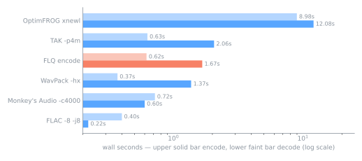

# FLQ — Filon Lossless Quality

[](https://github.com/nFeelon/flq-audio/actions/workflows/ci.yml)


FLQ is a lossless audio format for multi-track material: up to 255 tracks
(e.g. stems) coded as independent, CRC-checked frames of 16384 samples.
Every frame decodes on its own, so a player can jump anywhere, extract a
single stem, or keep going past a damaged frame — and a decoder needs
O(frame) memory. Inputs are WAV, AIFF/AIFF-C, FLAC and ALAC; samples are
kept exactly, and FLAC/ALAC tag blocks ride along. The bitstream is
specified in [`docs/SPEC-v1.md`](docs/SPEC-v1.md) with conformance vectors
in [`testdata/v1/`](testdata/v1/).

**Benchmark headline.** On the full 256-file sample corpus, 172
lossless inputs were accepted (WAV/AIFF/FLAC; lossy MP3/Ogg/m4a
rejected) and all 172 round-tripped sample-exact — output 58.7% of
source in 30.5 s total encode. On the 47-file subset every compared
tool accepted, `flq encode` produced 50.3% of the source size, vs
51.1% for FLAC -8 and 52.0% for WavPack -hx — smaller files than FLAC
on 46/47 inputs and ahead of Monkey's Audio (50.85%) on aggregate.

The deeper analysis chain (high-order LPC, LTP, LMS, rANS) spends CPU
on encode — ~240× realtime on 24 threads (~20× single-threaded) for a
10-minute WAV: still behind FLAC -8 (its own `-j8`), roughly at WavPack
-hx's pace, and ahead of TAK -p4m and OptimFROG on the same file.
Decode is light: ~290× realtime at one thread, ~650× with parallel
frames — in the same class as FLAC, WavPack and TAK.

[Full comparison and methodology](#vs-reference-codecs).

## Quick start

```console
cargo run --release -- encode drums.wav pad.flac stems.flq            # encode
cargo run --release -- decode stems.flq -o out/                       # all tracks
cargo run --release -- decode stems.flq --only pad.flac --range 30:45 # one stem, 15 s
cargo run --release -- info stems.flq
cargo run --release -- bench drums.wav pad.flac                       # encode+decode in memory
```

Requires Rust 1.85+ (edition 2024). The release binary lands at
`target/release/flq` — it is not added to PATH. Prebuilt binaries are
attached to [GitHub releases](https://github.com/nFeelon/flq-audio/releases).
Try it in the browser: [`web/`](web/) is a WASM player (mute/solo per
stem, seek, WAV export) — see [`web/README.md`](web/README.md). The
bundled 8-track **stems** demo is live at
[nfeelon.github.io/flq-audio](https://nfeelon.github.io/flq-audio/):

[](https://nfeelon.github.io/flq-audio/)

Options. `encode`: `-0`/`-5`/`-8` (LPC search depth; default `-5`, within
0.01 pp of exhaustive `-8`), `-j N` (threads; default all cores),
`--frame N` (frame length, multiple of 4096), `--no-index`. `decode`:
`-j N` (threads; default all cores), `--only name…`, `--range a:b`
(seconds), `--format wav|flac`
(default: the source's family). `bench` measures encode+decode in memory.
Every command refuses to overwrite existing files.

## Measured results

Dated reports: [`testdata/results/`](testdata/results/). Corpus: a
Freesound-derived sample pack (not redistributed).

### Full corpus — 256 files

| | Result |
|---|---|
| Inputs | 256 files — WAV / AIFF / FLAC / m4a / MP3 / Ogg |
| Accepted | **172** lossless (84 rejected: lossy MP3/Ogg/AAC + corrupt files) |
| Verified | 172/172 — decoded samples identical to source |
| Output | **58.7%** of source (1733 → 1018 MiB) |
| Encode / decode | 30.5 s total (≈57 MiB/s) / 13.1 s — 24 threads, `-5` defaults |
| Peak heap | ≤ 137 MiB (in-memory `bench` on the 73.6 MiB file); encode-only runs stay ≤ ~60 MiB |
| Seek | 0.1 s anywhere in a 600 s file: 6–20 ms wall, process start included |

By input kind — FLAC sources land near input size (already-compressed
payload), PCM compresses further: **FLAC input 97.8%** (24 files),
**AIFF 77.7%** (6), **WAV int 54.0%** (79), **WAV float 50.5%** (63).
Per-file numbers: [`2026-10-23_sweep256.md`](testdata/results/2026-10-23_sweep256.md).

Aggregate .flq size by input kind — lower is better:


### vs reference codecs

Same corpus, same files, single-file encode, verified decode — the
47-file subset every tool accepted (identical inputs):


FLQ lands at 50.27% — ahead of FLAC, WavPack and Monkey's Audio on
aggregate. Aggregate hides the per-file picture, so here is the
per-file breakdown — Δ is each file's (reference % − FLQ %), positive
meaning FLQ produced the smaller file on that input:

| FLQ vs | aggregate ref | smaller on | median Δ | worst file | best file |
|---|---|---|---|---|---|
| FLAC -8 | 51.15% | 46 / 47 | +1.08 pp | −2.5 pp | +13.8 pp |
| WavPack -hx | 52.04% | 35 / 47 | +1.26 pp | −0.4 pp | +31.1 pp |
| Monkey's Audio -c4000 | 50.85% | 25 / 47 | +0.05 pp | −1.7 pp | +34.7 pp |
| TAK -p4m | 49.88% | 9 / 47 | −0.50 pp | −2.4 pp | +8.2 pp |
| OptimFROG xnewl | 48.40% | 1 / 47 | −1.69 pp | −9.2 pp | +1.1 pp |
| 7-Zip LZMA2 -mx9 | 64.60% | 40 / 47 | +12.19 pp | −55.3 pp | +49.6 pp |
| Zstd --ultra -22 | 78.08% | 43 / 47 | +26.54 pp | −15.4 pp | +78.6 pp |

FLQ's lead over FLAC and WavPack is consistent — 46/47 and no loss
worse than 2.5 pp — while Monkey's Audio is a per-file coin flip that
FLQ still wins on aggregate. TAK and OptimFROG stay ahead overall, but
the median per-file gap to TAK is only half a point.

Encode and decode wall time on one 73.6 MiB i16 stereo 48 kHz WAV
(~6.7 min), `flq` at all 24 cores; references at their bench settings
(incl. `flac -j8`). Numbers:
[`2026-10-23_encspeed.md`](testdata/results/2026-10-23_encspeed.md):



Faster than TAK and far faster than OptimFROG on encode, near
WavPack's pace, ~7.6× behind FLAC — and decode lands in the
FLAC/WavPack/TAK class (~650× realtime).

## What each format becomes

Samples are kept exactly; the input file container is not (a WAV comes
back as a WAV with identical audio bytes, not necessarily identical
headers; a FLAC comes back re-encoded with its tag blocks preserved).

| Input | Stored as | `decode` gives (default) | Guarantee |
|---|---|---|---|
| WAV (int 8/16/24/32, float 32/64, extensible) | framed LPC+LTP/rANS | WAV | sample-exact |
| AIFF / AIFF-C | framed LPC+LTP/rANS | WAV | sample-exact |
| FLAC | framed LPC+LTP/rANS + tag blocks | FLAC (or WAV) | sample-exact + tags |
| ALAC (`.m4a`) | framed LPC+LTP/rANS + tags | FLAC (or WAV) | sample-exact + tags |
| MP3, AAC, Ogg | rejected — flq is lossless | | |

## How it works

```text
header 28 B   "FLQ1" | 1 | flags | ntracks | frame_len | meta_len | index_off | crc
meta          per track: name, origin, rate, channels, mask, format, frames, pcm_crc, tags
frames        t0f0 t1f0 t0f1 t1f1 …   each: "FQ" | track | fmode | e | frame_no | n | len | payload | crc32
index         per track: frame offsets (u64) + crc32          (optional; frames resync without it)
```

A frame payload is the codec applied to `frame_len` samples (default
16384): 4096-sample blocks, per block a stereo mode (L/R, L/S, R/S, M/S,
plus two adaptive-gain modes on a 1/128 grid), per signal LPC up to order
63 with 15-bit coefficients, then optional long-term pitch prediction
(lag ≤ 4095) and an adaptive two-tap sign-sign pass on the residual, and
finally partitioned coding where each partition picks Rice, escape, or an
adaptive rANS quotient coder; float tracks split into an integer
significand stream plus exact tail bits. History resets at every frame
start; the first `order` samples are stored verbatim, which keeps the
frame cost at +0.10 pp over continuous coding. Seeking reads the
index, decodes one frame and trims.

Encoding streams WAV/AIFF input frame by frame and schedules frames
through a bounded job queue — workers pull jobs, payloads are emitted
in frame order, so output is byte-identical for any `-j`. The hot
loops (LPC dot products, residual prefix scans, rANS context updates)
take AVX2 paths on x86-64 with scalar fallbacks elsewhere. Decoding
streams frame by frame (0.6 MiB heap at `-j1` for a 77 MB WAV). There
are no cross-track references anywhere in the codec or the wire
format.

## Modules

| Path | Role |
|---|---|
| `src/v1/` | the format: header/meta/frame/index layouts (`mod.rs`), streaming encoder with the parallel frame pipeline (`enc.rs`), `Reader` with seek, range decode, resync (`dec.rs`) |
| `src/codec.rs` | float split, stereo modes incl. adaptive gain, LPC (presets, warm-up, AVX2 dot paths), LTP, LMS pass, block plan/write/read, `FLQ_PROF`-gated timing (`prof`) |
| `src/bits.rs` | MSB-first bit IO, partition planning (Rice + escape + rANS probes, early-abort on losing candidates), CRC32 |
| `src/rc.rs` | adaptive-binary rANS core — u16-cell renormalization, LUT adaptation, multiply-high divisions |
| `src/formats.rs` | sniffing, FLAC/ALAC decode via symphonia, tag blobs, self-verified FLAC/WAV output |
| `src/wav.rs` · `src/aiff.rs` | container parsing (whole-file and header-only) and write-back |
| `src/main.rs` | CLI + timing/heap metrics |
| `wasm/` · `web/` | dependency-free WASM decoder exports + browser player |
| `fuzz/` | cargo-fuzz target for the v1 reader |

Bitstream spec: [`docs/SPEC-v1.md`](docs/SPEC-v1.md). Architecture and
contributor notes: [`AGENTS.md`](AGENTS.md).

## Limitations

**Memory.** Decode keeps ~`threads` frames in flight (0.6 MiB counted
heap at `-j1`, ~21 MiB at `-j24`); encode reads WAV/AIFF frame by
frame, but FLAC/ALAC inputs are still decoded whole into memory first.
Parallel encode peaks ~40–58 MiB across the corpus — more than the
reference codecs — because each worker holds a frame's full codec
scratch; `bench` (in-memory round-trip) additionally holds decoded
PCM, up to ~137 MiB on the largest file.

**Format coverage.** Integer 8/16/24/32-bit, float 32/64-bit, 1–16
channels; lossy inputs (MP3, AAC, Ogg) are refused — flq is lossless
only. WAV output drops tags; FLAC output can't hold float or 32-bit int;
FLAC/ALAC are re-encoded on output (samples and tags preserved, original
bytes not); ALAC comes out as FLAC; SEEKTABLE/PADDING not preserved.

**Structure.** 255 tracks max per `.flq`. Frames are independent — a
corrupt frame costs at most that frame, and only on its own track.

**Speed.** Encoding spends real CPU on its analysis chain (~240×
realtime at 24 threads, ~20× single-threaded — behind FLAC, ahead of
TAK/OptimFROG); decoding parallelizes across frames (`-j`, default all
cores, ~650×) and stays a streaming O(frame) reader (~290× at `-j1`).

**Status.** Experimental tool. The v1.0 bitstream is frozen by the spec
and conformance vectors. Results from one corpus — not yet checked on a
second collection (e.g. music masters).

## Development

```console
cargo test --release                # unit + conformance + mutation tests
cargo test --release -- --ignored   # + vector/demo generators
cargo clippy --release --all-targets
```

CI: GitHub Actions — `ci.yml` (build, tests and clippy on Ubuntu and
Windows; 60 s cargo-fuzz run on nightly), `release.yml` (binaries for
Linux/Windows/macOS on `v*` tags), `pages.yml` (builds the WASM player
and deploys `web/` to GitHub Pages).

- [`AGENTS.md`](AGENTS.md) — invariants, wire format, contributor notes
- [`testdata/`](testdata/) — tracked fixtures, v1 conformance vectors,
  dated measurement reports
- [`docs/make_assets.py`](docs/make_assets.py) — regenerates the banner
  and charts above

## License

[MIT](LICENSE) © 2026 Nikita Filon
